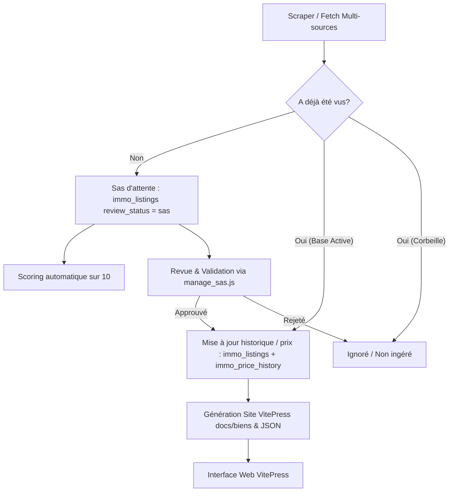

# Consignes de Naming et Règles de Localisation

Ce document regroupe les règles de formatage et de naming à appliquer sur les annonces immobilières de Brest.

## Règle de Naming (Titre Personnalisé)

> [!IMPORTANT]
> Pour chaque annonce immobilière, le titre de la fiche markdown **doit inclure la localisation précise** (le quartier ou secteur) dès qu'il est identifiable dans le titre d'origine, la description ou les métadonnées. Il ne faut pas se contenter de la mention générique "Brest".
> 
> **Exclusion stricte pour absence de quartier** : Toute annonce pour laquelle **aucun quartier reconnu ne peut être identifié** est **strictement éliminée**. Elle est ignorée au fetch (`fetch_listings.js`) et déplacée automatiquement en `corbeille/` lors du scoring (`score_listings.js`).

### Quartiers reconnus et prioritaires
Les quartiers suivants doivent être extraits et insérés au centre du titre :
- **Siam** / **Triangle d'Or** / **Saint-Louis**
- **Place Wilson** / **Gare** / **Branda**
- **Saint-Michel** / **Gambetta** / **Pasteur**
- **Capucins** / **Recouvrance** / **Kerbonne** / **La Corniche**
- **Saint-Marc** (Hors secteur) / **Guelmeur** / **Saint-Martin**
- **Kérinou** / **Lanrédec** / **Linois**
- **Harteloire** / **Bellevue** / **Pilier Rouge**
- **Port de Commerce**

### Format du Titre
Le titre (`immo_listings.title`) suit le format `Type surface Quartier complément` : type, surface et quartier sont des données fiables qui identifient le bien, le complément donne les 1 ou 2 atouts distinctifs (analyse IA, à défaut mots-clés). Il est calculé par `buildHeadline` (`shared/listing_utils.js`).

Exemples :
- `Maison 141 m² Saint-Michel avec jardin et garage`
- `Appartement 97 m² Capucins avec vue mer et terrasse`
- `Appartement 120 m² Gare avec balcon, seul à l'étage`

## Restitution des Résultats du Fetch

> [!IMPORTANT]
> Après chaque exécution du script de fetch (`fetch_listings.js`), l'agent doit **systématiquement et explicitement** présenter à l'utilisateur la liste des nouvelles annonces découvertes et placées dans le sas d'attente (`review_status = 'sas'` dans Supabase).
> Pour chaque annonce découverte, il convient d'indiquer :
> - La source (Leboncoin, Agence Henry, Luxior, Barraine, Human)
> - Le type de bien, quartier, surface, prix (ou "Prix sur demande")
> - Le score calculé automatiquement
> - Le lien de l'annonce (si disponible)

---

# Architecture, Mécanismes et Skills ImmoBrest

Ce document décrit le fonctionnement global de la plateforme d'analyse et de recherche immobilière sur Brest.

## 1. Ce que propose l'application ImmoBrest

ImmoBrest est une plateforme automatisée de recherche, d'évaluation et de consultation de biens immobiliers sur Brest centre. Elle permet de :
- **Agréger les annonces** issues de plusieurs sources (Leboncoin, Agence Henry, Luxior, Barraine, Human Immobilier).
- **Filtrer strictement** selon la surface (85–150m²) et le budget (300k–600k€).
- **Dédoublonner automatiquement** les annonces publiées sur plusieurs portails.
- **Sécuriser la base active via un Sas d'attente** afin de vérifier les nouvelles annonces avant publication.
- **Évaluer et noter chaque bien sur 10 points** selon une grille multicritères (Tiers 1: Siam/Wilson/Gare..., Tiers 2: Saint-Michel/Gambetta/Fac de médecine/Facultés/Yves Collet/Capucins..., Tiers 3: Autres). Exclusions strictes: Croix-Rouge, Bellevue, Saint-Marc, Lambézellec, Bohars, Saint-Pierre, Quatre Moulins, Kerbonne, Fontaine Margot, Les Jardins de la Falaise, Rive Droite (hors Capucins/Recouvrance).
- **Croiser avec les ventes réelles DVF (DGFiP)** géolocalisées sur Brest.
- **Générer un site statique dynamique VitePress** proposant un tableau de bord interactif, des filtres et des fiches détaillées avec historique des prix.

---

## 2. Structure des Données

Les annonces vivent dans le projet **Supabase partagé** (avec DraftMaster et Quiz), tables préfixées `immo_`. Les scripts utilisent la clé `service_role` lue dans `.env` (voir `.env.example`) : lancer avec `node --env-file=.env <script>`. Le schéma est dans `supabase/migrations/`.

- `immo_listings` : une ligne par annonce. `review_status` vaut `sas` (**sas d'attente**, nouvelles annonces à valider), `approved` (**base active** publiée sur le site) ou `rejected` (**corbeille**, sert aussi d'anti-doublon pour ne jamais ré-ingérer une annonce rejetée). `market_status` porte l'état sur le marché (Actif, Vendu ou retiré de la vente...).
  - Dates : `first_seen_at` = première fois que les relevés ont vu l'annonce (entrée dans le référentiel), `last_seen_at` = dernier relevé où elle était en ligne, `published_at` = date de publication indiquée par la source (Leboncoin).
  - `photos` : URLs des photos (la première sert de vignette), relevées par le fetch ou par l'enrichissement.
  - `ai_analysis` : analyse Gemini de la description (caractéristiques oui/non/inconnu, état, DPE, complément de titre, points forts/faibles), utilisée par le scoring.
- `immo_price_history` : historique des prix par annonce.
- `immo_dvf_sales` : transactions réelles DGFiP sur Brest.
- `immo_run_log` : journal des exécutions du fetch (date de dernière recherche, statistiques, erreurs).
- `immo_allowed_emails` : e-mails autorisés à consulter et modérer.
- `leboncoin_searches/<id>/latest_screenshot.png` : captures d'écran des annonces à fort score (les anciens dossiers `.md` sont conservés comme archive historique, plus lus par les scripts).
- `dvf_data/` et `docs/public/dvf/` : données DVF brutes et parsées ; `docs/` : site statique VitePress (`docs/biens/`, `docs/public/listings_data.json`), généré depuis la base.

---

## 3. Principaux Mécanismes du Pipeline

1. **Ingestion (Fetch & Multi-dédoublonnage)** :
   - Scan Chrome Debugging sur Leboncoin + requêtes HTTP sur agences partenaires.
   - Contrôle anti-doublon global (toutes les annonces de `immo_listings`, quel que soit leur `review_status`).
2. **Sas d'attente (Staging)** :
   - Toute nouvelle propriété entre dans `immo_listings` avec `review_status = 'sas'`.
   - Le scoring est immédiatement calculé pour faciliter la décision.
3. **Validation / Modération** :
   - L'utilisateur ou l'agent valide (`manage_sas.js approve`) ou rejette (`manage_sas.js reject`).
4. **Enrichissement** (`listing_enrich`, lancé par le fetch avant le scoring) :
   - Photos manquantes, analyse Gemini des annonces nouvelles ou modifiées (empreinte `input_hash`), titre normalisé.
5. **Scoring Multicritères** :
   - Note initiale de 10/10 déduite des maluses (Tiers localisation, prestations manquantes).
   - Avec l'analyse IA, chaque critère vaut oui / non / non précisé : « non précisé » coûte 3/4 du malus (au lieu du malus complet quand le texte ne mentionne rien). Le bonus qualité vient de l'état réel (neuf/rénové +0.5, à rafraîchir −0.5, gros travaux −1) et de la vue mer (+0.5), plafonné à +1 ; DPE F/G −0.5.
   - Sans analyse IA (pas de clé, échec), repli sur les expressions régulières et les mots-clés (+0.2 par mot-clé, max +1.0).
6. **Publication HTML (VitePress)** :
   - Exécution de `generate_site.js` pour créer les fiches markdown dans `docs/biens/` et la base JSON `docs/public/listings_data.json`.

---

## 4. Catalogue des Skills & Helper Scripts

### 🔍 `leboncoin_fetch` (Ingestion & Gestion du Sas)
- **Scraper d'annonces** : `node --env-file=.env .agents/skills/leboncoin_fetch/scripts/fetch_listings.js`
  - `--sources=leboncoin,henry,luxior,barraine,human` : limite les sources interrogées (toutes par défaut). Leboncoin s'exécute sur le PC (Chrome en debug, tâche planifiée `scripts/run_local_fetch.ps1`), Henry, Barraine et Luxior tournent dans le cloud (`.github/workflows/fetch-cloud.yml`, cron quotidien). **Human est en pause** : son site répond 403 aux scrapers (cloud comme PC), ne pas chercher à contourner cette protection.
  - `--dry-run` : exécute tout le pipeline sans rien écrire dans la base.
  - Le scoring est lancé automatiquement à la fin, et chaque exécution est tracée dans `immo_run_log`.
- **Lister le Sas d'attente** : `node --env-file=.env .agents/skills/leboncoin_fetch/scripts/manage_sas.js list`
- **Valider une annonce du Sas** : `node --env-file=.env .agents/skills/leboncoin_fetch/scripts/manage_sas.js approve <id|all>`
- **Rejeter une annonce du Sas** : `node --env-file=.env .agents/skills/leboncoin_fetch/scripts/manage_sas.js reject <id|all> [motif]`

### 📊 `leboncoin_scoring` (Calcul des Notes)
- **Scorer toutes les annonces (actives + sas)** : `node --env-file=.env .agents/skills/leboncoin_scoring/scripts/score_listings.js` (`--dry-run` pour simuler)

### 🤖 `listing_enrich` (Photos, analyse IA, titres)
- **Enrichir les annonces actives et du sas** : `node --env-file=.env .agents/skills/listing_enrich/scripts/enrich_listings.js`
  - `--dry-run` (aucune écriture), `--force` (réanalyse tout), `--only=<id>`, `--no-ai`, `--no-photos`.
  - Clés Gemini gratuites lues dans `GEMINI_API_KEYS` / `GEMINI_API_KEY*` (rotation sur quota 429), modèle `GEMINI_MODEL`. Dans le cloud, ajouter le secret GitHub `GEMINI_API_KEYS`, sinon l'analyse est ignorée. Quand toutes les clés sont épuisées, l'analyse texte passe par DeepSeek (DeepSeek V4.1 Flash via OpenRouter) si `OPENROUTER_PREMIUM_API_KEY` est défini (même clé que DraftMaster, modèle `FALLBACK_MODEL`, secret GitHub du même nom).
  - Annonces Henry : la première photo de la fiche Henry est lue par Gemini ; un bandeau « offre acceptée / sous offre / vendu » fait passer l'annonce en « Vendu ou retiré de la vente » (résultat gardé par photo dans `ai_analysis.photo_banner`). DeepSeek ne lit pas les images : sans quota Gemini, la vérification attend le relevé suivant.
  - Leboncoin : quand Chrome est ouvert en mode debug, les fiches sans photos ou sans date de publication sont ouvertes pour relever les photos et la date de création de l'annonce.
  - Relancer ensuite le scoring pour appliquer les nouvelles analyses (le fetch le fait automatiquement).

### 💻 `leboncoin_display` (Consultation CLI)
- **Afficher les annonces actives** : `node --env-file=.env .agents/skills/leboncoin_display/scripts/display_listings.js`
- **Afficher les annonces du Sas d'attente** : `node --env-file=.env .agents/skills/leboncoin_display/scripts/display_listings.js --sas`

### 🌐 `leboncoin_generate_site` (Génération Web)
- **Régénérer les fiches et données du site depuis la base** : `npm run generate`
- **Lancer le serveur de développement VitePress** : `npm run dev`
- `npm run build` compile uniquement le site à partir des fichiers déjà générés (utilisé par le déploiement GitHub Pages, sans accès à la base) ; `npm run build:full` régénère puis compile.

### 📱 `app/` (Application privée Next.js, à déployer sur Railway)
- Site protégé par mot de passe (`SITE_PASSWORD`, cookie signé avec `SESSION_SECRET`) : **Sas** (Accepter / Rejeter avec motif), **Annonces**, fiche détaillée (historique de prix, comparaison DVF), **Archives**, **Corbeille** (remettre dans le sas).
- Lit et écrit dans Supabase côté serveur uniquement (clé `service_role`, jamais envoyée au navigateur). Variables : voir `app/.env.example`.
- Local : `cd app && npm install && npm run dev` (variables dans `app/.env.local`, ignoré par git).
- Production : projet Railway `immoBrest`, service `web`, https://web-production-72ad5c.up.railway.app . Redéployer depuis `app/` : `railway up --service web --detach` (déploiement par envoi du dossier, pas encore relié à GitHub). Variables Railway : `SUPABASE_URL`, `SUPABASE_SERVICE_ROLE_KEY`, `SITE_PASSWORD`, `SESSION_SECRET`.

### 🗄️ `supabase_sync` (Migration)
- **Migration unique des fiches markdown vers Supabase** : `node --env-file=.env .agents/skills/supabase_sync/scripts/migrate_files_to_supabase.js [--apply]` (dry-run par défaut ; n'insère que les lignes absentes).

### 🗺️ `dvf` (Données Ventes Réelles DGFiP)
- **Télécharger et géolocaliser les données DVF sur Brest** : Voir instructions dans `.agents/skills/dvf/SKILL.md`.

